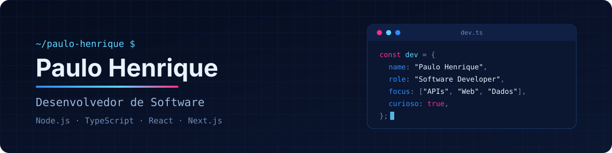

  <!-- Descomente e troque pelo link do seu LinkedIn:
  
  -->
  

#### Sobre

Desenvolvedor back-end júnior (Node.js e TypeScript) no time de plataforma da [Klubi](https://klubi.com.br). Construo APIs, integrações e processamento assíncrono para uma ferramenta de atendimento omnichannel (WhatsApp Business API, RCS, SMS e Instagram Direct) usada todos os dias por times de atendimento e vendas. No front, uso React e Next.js.

Vim de uma carreira fora de TI e entrei em tecnologia por helpdesk e QA. Por isso, investigo a causa raiz antes de corrigir e valido o comportamento em produção.

Cursando Análise e Desenvolvimento de Sistemas na UNIP.

#### O que tenho feito

- Integrei o Instagram Direct como canal de atendimento, com resposta automática por agente de IA
- Criei métricas e observabilidade de disparos de templates do WhatsApp Business API
- Separei o processamento assíncrono em filas por canal, com DLQ para mensagens com falha
- Troquei polling por SSE nas notificações, o que reduziu a carga no backend
- Desenvolvi funcionalidades do editor visual de automações e da gestão de atendentes, com RBAC e trilha de auditoria

#### Stack

  
  
  
  
  
  
  
  
  

#### Projeto em destaque

**[NEXUS](https://github.com/phromeiro7/NEXUS)**: assistente pessoal de tarefas, lembretes e finanças. Você registra por mensagem no Telegram e organiza o dia no painel web ou no Mini App. API em Hono, lembretes em fila com `pg_cron`, idempotência e isolamento por usuário com RLS no Postgres.

TypeScript · Hono · Next.js · Supabase · Postgres · Telegram Bot API

#### Trajetória

- Analista de Sustentação e Qualidade Jr. (atuação como Desenvolvedor, time de Plataforma), Klubi, 2026 até hoje
- Estagiário de Helpdesk, Klubi, 2025 a 2026
- Análise e Desenvolvimento de Sistemas, UNIP, em andamento
